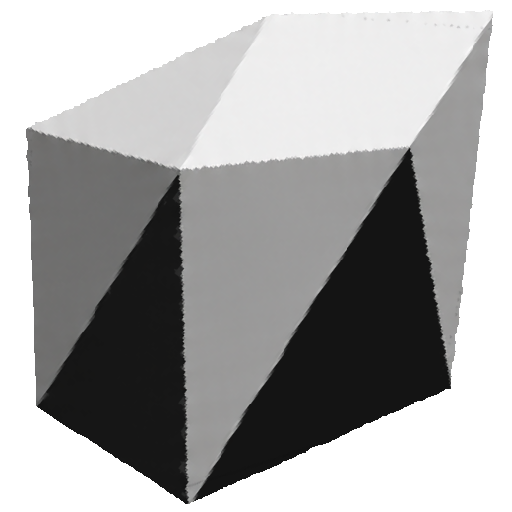

<h1>
  
  ONICS
</h1>

## Guida ai metodi di `Input`

Wrapper del nuovo Input System con la sintassi del vecchio. In ogni gruppo il primo metodo è quello più simile al vecchio `UnityEngine.Input`; gli altri sono alias o varianti.

Tutti i metodi che accettano `InputKey` hanno anche l'overload `InputKey[]`: restituisce `true` se **almeno uno** degli input dell'array soddisfa la condizione.

## Tipi di supporto

| Tipo | Descrizione |
|---|---|
| `InputKey` | Struct serializzabile (visibile in Inspector) con `device`, `key`, `mouseButton`, `gamepadButton`. Il campo usato dipende da `device`. |
| `InputDeviceType` | `Keyboard`, `Mouse`, `Gamepad` |
| `MouseButton` | `Left`, `Right`, `Middle`, `Forward`, `Backward` |
| `GamepadButton` | `Start`, `Select`, `L1`, `R1`, `L2`, `R2`, `L3`, `R3`, `South`, `North`, `East`, `West`, `DPadUp`, `DPadDown`, `DPadLeft`, `DPadRight` |

## Pulsanti e tasti (tastiera / mouse / gamepad)

| Metodo | Funzionamento | Equivalente vecchio Input |
|---|---|---|
| `GetKeyDown(InputKey)` | `true` nel frame in cui l'input viene premuto | `Input.GetKeyDown` |
| `PUSH(InputKey)` | Alias di `GetKeyDown` | – |
| `DOWN(InputKey)` | Alias di `GetKeyDown` | – |
| `GetKey(InputKey)` | `true` finché l'input è tenuto premuto | `Input.GetKey` |
| `HOLD(InputKey)` | Alias di `GetKey` | – |
| `KEEP(InputKey)` | Alias di `GetKey` | – |
| `GetKeyUp(InputKey)` | `true` nel frame in cui l'input viene rilasciato | `Input.GetKeyUp` |
| `LEFT(InputKey)` | Alias di `GetKeyUp` | – |
| `PULL(InputKey)` | Alias di `GetKeyUp` | – |

## Pulsanti del mouse (senza `InputKey`)

| Metodo | Funzionamento | Equivalente vecchio Input |
|---|---|---|
| `GetMouseButtonDown(int)` | `true` nel frame della pressione (0 = sinistro, 1 = destro, 2 = centrale, 3 = avanti, 4 = indietro) | `Input.GetMouseButtonDown` |
| `GetMouseButtonDown(MouseButton)` | Come sopra, usando l'enum | – |
| `GetMouseButton(int)` | `true` finché il pulsante è tenuto premuto | `Input.GetMouseButton` |
| `GetMouseButton(MouseButton)` | Come sopra, usando l'enum | – |
| `GetMouseButtonUp(int)` | `true` nel frame del rilascio | `Input.GetMouseButtonUp` |
| `GetMouseButtonUp(MouseButton)` | Come sopra, usando l'enum | – |

## Posizione e movimento del mouse

| Metodo | Tipo | Funzionamento | Equivalente vecchio Input |
|---|---|---|---|
| `mousePosition` | `Vector3` | Posizione del cursore in pixel | `Input.mousePosition` |
| `MOUSE_POSITION` | `Vector2` | Posizione del cursore in pixel (alias) | – |
| `MOUSE_MOVEMENT` | `Vector2` | Spostamento del mouse nel frame (delta) | `Input.GetAxis("Mouse X/Y")` |
| `MOUSE_MOVING` | `bool` | `true` se il mouse si è mosso nel frame | – |

## Rotellina del mouse

| Metodo | Tipo | Funzionamento | Equivalente vecchio Input |
|---|---|---|---|
| `mouseScrollDelta` | `Vector2` | Scroll del frame (x e y) | `Input.mouseScrollDelta` |
| `MOUSE_WHEEL` | `float` | Scroll verticale del frame | `Input.mouseScrollDelta.y` |
| `MOUSE_WHEEL_UP` | `bool` | `true` se si scorre verso l'alto (`MOUSE_WHEEL > 0`) | – |
| `MOUSE_WHEEL_DN` | `bool` | `true` se si scorre verso il basso (`MOUSE_WHEEL < 0`) | – |

## Qualsiasi tasto

| Metodo | Funzionamento | Equivalente vecchio Input |
|---|---|---|
| `anyKeyDown` | `true` nel frame in cui un tasto qualsiasi viene premuto | `Input.anyKeyDown` |
| `anyKey` | `true` finché un tasto qualsiasi è premuto | `Input.anyKey` |
| `anyKeyUp` | `true` nel frame in cui un tasto qualsiasi viene rilasciato | – (non esiste nel vecchio) |

## Touch e sensori

| Metodo | Funzionamento | Equivalente vecchio Input |
|---|---|---|
| `touchCount` | Numero di tocchi registrati dal touchscreen | `Input.touchCount` |
| `GetTouch(int index)` | Restituisce il `TouchControl` all'indice indicato | `Input.GetTouch` |
| `acceleration()` | Valore dell'accelerometro (`Vector3`) | `Input.acceleration` |

## Metodo di basso livello

| Metodo | Funzionamento |
|---|---|
| `GetButton(InputKey)` | Restituisce il `ButtonControl` corrispondente (o `null`). Utile per accedere direttamente a `wasPressedThisFrame`, `wasReleasedThisFrame`, `isPressed` o al valore analogico (es. trigger L2/R2). |

## Note

- `touchCount`, `GetTouch` e `acceleration()` lanciano eccezione se il dispositivo non è presente (`Touchscreen.current` / `Accelerometer.current` sono `null`). Sull'accelerometro, ricordati di abilitarlo con `InputSystem.EnableDevice`.
- Per il gamepad, `GetButton` usa `Gamepad.current`: se non c'è nessun gamepad collegato lancia eccezione.
- `GetKeyDown`, `GetKeyUp` e `GetKey` con `InputKey` usano `?.` e restituiscono `false` se il controllo è `null`.
